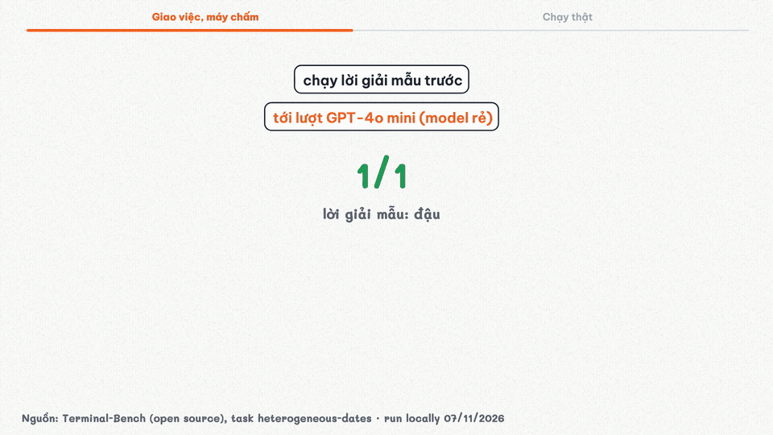
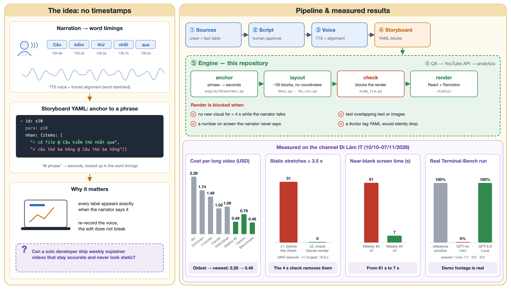

# whiteboard-explainer-engine

**Write a storyboard in YAML, get a hand-drawn explainer video.** An open-source whiteboard animation engine for
automated (faceless) YouTube explainer videos: AI voice-over, word-level sync, real screen recordings, rendered with Remotion.
This is the rendering engine behind my YouTube channel
[**Đi Làm IT**](https://www.youtube.com/channel/UC8sOld_v0uCZfoKKXVnwiHQ), where every episode is researched, voiced,
drawn and rendered by a pipeline I built with AI, and checked by me before it goes out.



80-second demo built from this repo: `scripts/demo.sh` → `out/demo.mp4`. Full episode: https://youtu.be/OWCMEja1pzo

| Episode (Vietnamese) | What the engine did |
|---|---|
| [Benchmark AI chấm thế nào? — Alex chạy thật Terminal-Bench](https://youtu.be/OWCMEja1pzo) | Real terminal recordings of two models taking the same test, played inside the drawing |
| [Gemini 4 Carbon: model mạnh nhất bảng, mà Google chưa cho bạn dùng](https://youtu.be/_D273S8DKv8) | 46 scenes, 11 annotated source screenshots, every number cited on screen |
| [Ai đã biết trước 4 ngày? Lỗ hổng PHP 9,2 điểm](https://www.youtube.com/watch?v=EGwKD2uKURk) | Documentary-style event explainer, the channel's most-watched long video |

## What it does

```yaml
- id: s10
  para: p10                       # narration paragraph this scene belongs to
  anh: {src: clip-mini-tests.png, video: clip-mini-tests.mp4, o: trai}   # real recording, plays in the frame
  nhan: {o: tren-phai, items: [
    "✓ có file @ Câu kiểm thứ nhất qua #xanh-la",      # appears when the narrator says this phrase
    "✗ câu thứ ba hỏng @ Câu thứ ba hỏng #do",
    "nó ghi: 18,286 @ nó ghi mười tám phẩy hai tám sáu #do"]}
  nguon: "TB, máy chấm (lần 1) @ Đến lượt máy chấm"  # source line, required whenever a real image is shown
```

- **No timestamps.** Each element says *which words* it belongs to (`@ phrase`). Word-level timings from the voice track
  turn phrases into seconds, so re-recording the narration never breaks the edit.
- **~30 building blocks** (`anh`, `anh_khoanh`, `con_so`, `cot`, `code`, `checklist`, `the_tin`, `luong`, `thuoc_thoi_gian`…)
  placed by a layout system, so a storyboard never contains coordinates unless it wants to.
- **Hand-drawn look**: rough.js strokes, a drawing hand that follows each stroke, paper texture, chapter bar.
- **Checks that block the render** (the part I'm most proud of, because each one came from a real mistake):
  - a stretch longer than 4 s where the narrator talks but nothing new appears on screen,
  - text overlapping text or images,
  - a number shown on screen that the narrator never says (catches wrong figures before they ship),
  - a `#color` tag outside quotes, which YAML silently treats as a comment.

## How it works



Only the engine (box ⑤) is open here. Research, voice, publishing and analytics live in a private repo.
The figure is generated by [`docs/make_figure.py`](docs/make_figure.py); every number in it is measured, not estimated.

**Numbers from the private repo** (07/11/2026): 32 videos and Shorts in 4 weeks, 125 commits,
0.46–2.28 USD per long video at first release (images + voice; the three newest are under 0.80 USD),
about 5 minutes to render a 6-minute episode on a laptop.

## Run the demo

Requirements: Python 3.12, Node 20+, ffmpeg.

```bash
python3 -m venv .venv && .venv/bin/pip install -r requirements.txt
(cd studio && npm ci)
PYTHON=.venv/bin/python scripts/demo.sh --check   # storyboard checks only
PYTHON=.venv/bin/python scripts/demo.sh           # → out/demo.mp4 (80 s)
.venv/bin/pytest -q                                # engine tests
```

The demo is 80 seconds of the benchmark episode: narration, images and terminal recordings are in
[`examples/terminal-bench/`](examples/terminal-bench/). No API keys needed.

## Layout

| Path | What |
|---|---|
| `engine/khuon/` | Storyboard → timeline: blocks (`khoi.py`), layout (`bo_cuc.py`), phrase anchors (`moc.py`), checks (`kiem_tra.py`), event-style extras (`su_kien.py`) |
| `engine/whiteboard.py` | Low-level timeline builder (text, images, shapes, hand) |
| `studio/` | Remotion + React renderer for the timeline JSON |
| `examples/terminal-bench/` | Demo storyboard, voice with word timings, assets |

Code comments and block names are in Vietnamese: the channel is Vietnamese and so is the team (me + AI) that writes the storyboards.

## Tiếng Việt

**Làm video YouTube giải thích tự động bằng AI, kiểu vẽ tay trên bảng trắng.** Đây là phần dựng hình của kênh **Đi Làm IT**: viết storyboard bằng YAML, mỗi chi tiết gắn với câu người kể đang đọc, máy tự đặt
vị trí, vẽ nét tay, chèn ghi màn hình thật, và **chặn render** nếu có quãng hơn 4 giây không có hình mới, chữ đè nhau, hay
con số trên hình không khớp lời đọc. Phần nghiên cứu, giọng, đăng và đo số liệu nằm ở repo riêng.

## License

Engine code: MIT. Renderer depends on [Remotion](https://www.remotion.dev/license) (free for individuals and small teams).
Narration, drawings and recordings in `examples/` are from the channel and included only to run the demo.
